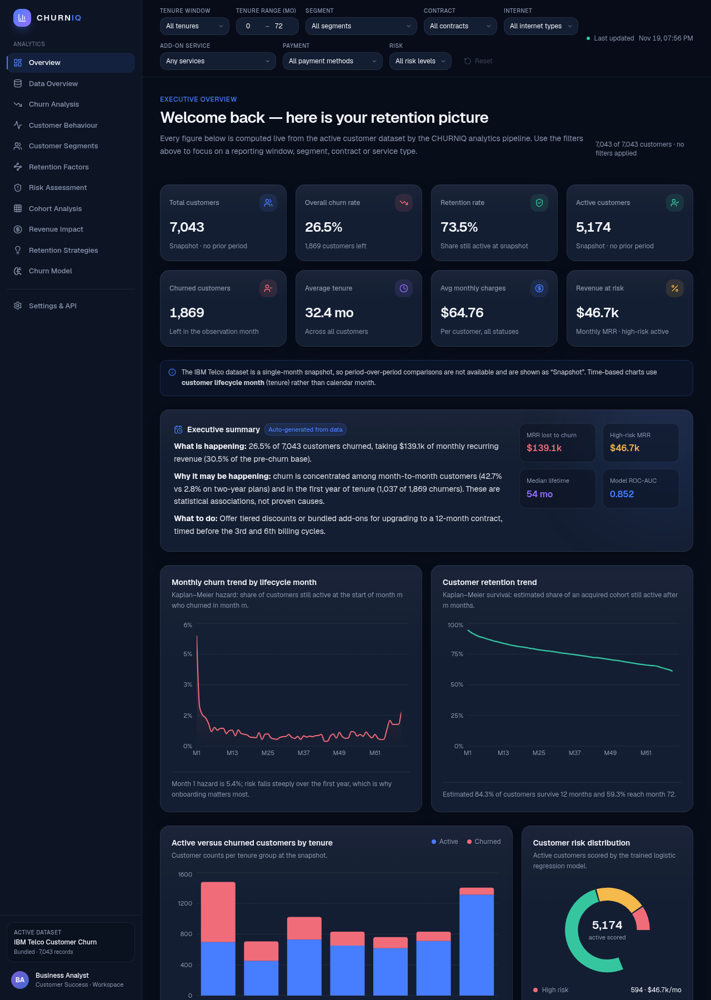
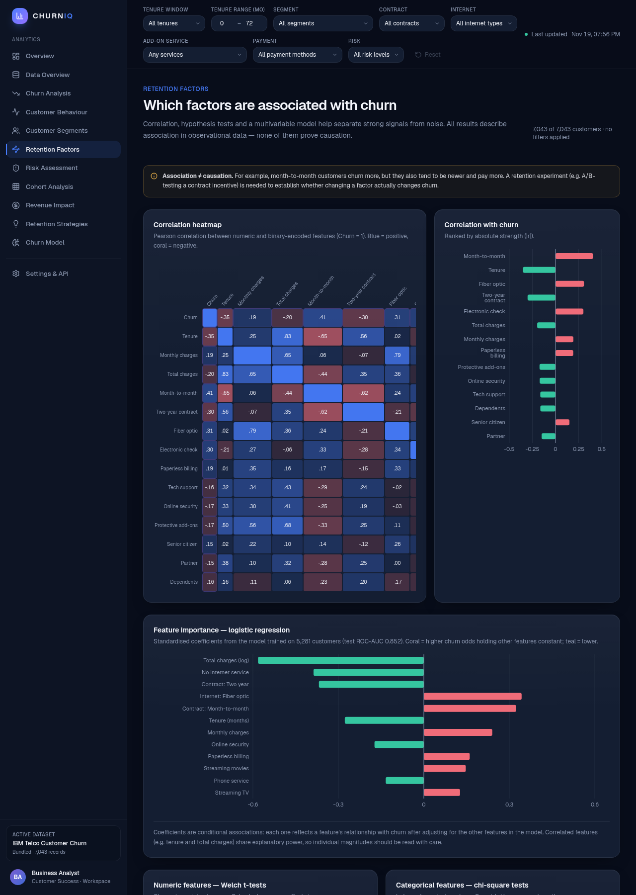
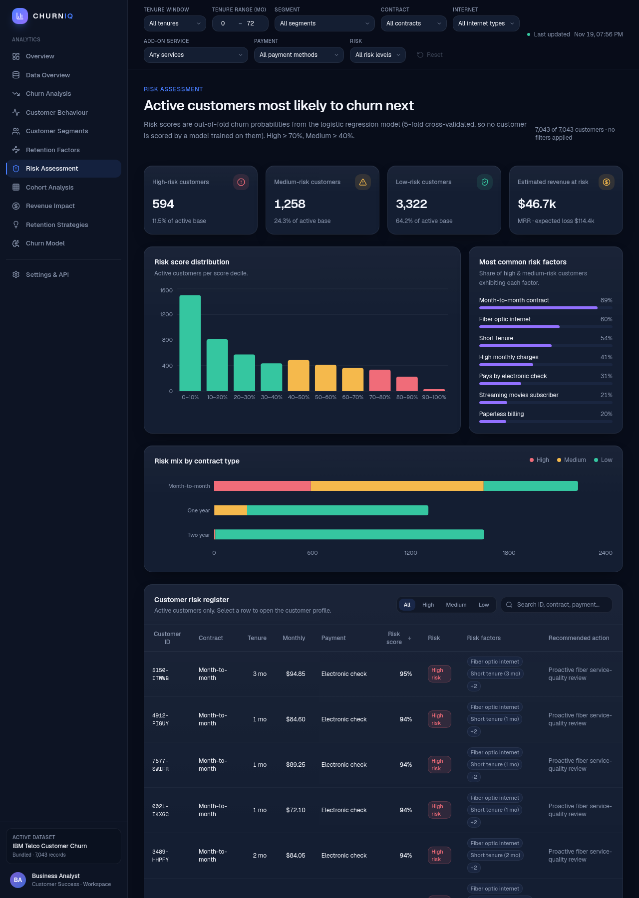
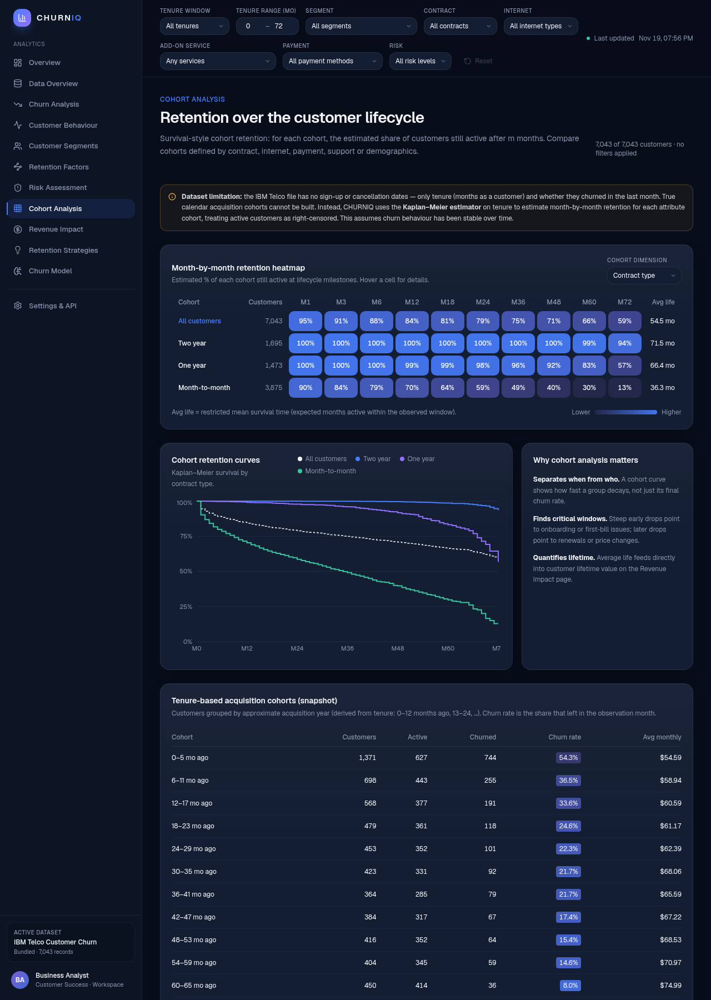
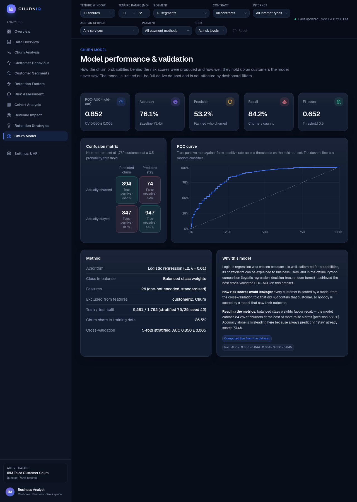
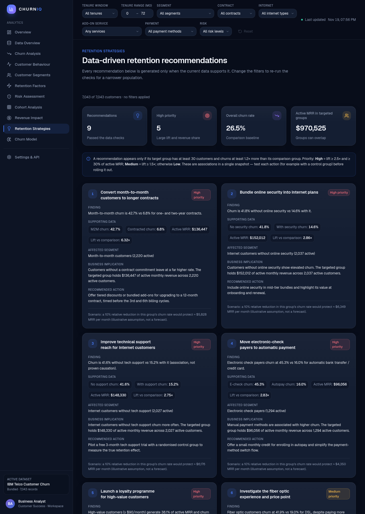

# CHURNIQ — Customer Churn & Retention Analytics

CHURNIQ is an interactive business-analytics dashboard that explains **who churns, why they may churn, what it costs and what to do about it**, calculated end to end from the IBM Telco Customer Churn dataset.



## 1. Business problem
Subscription businesses lose recurring revenue whenever customers cancel. Retention teams need to know which customers leave, which attributes are associated with leaving, how much revenue is exposed, and which interventions are worth testing — backed by data, not assumptions.

## 2. Objectives
- Load, validate and clean a real customer dataset (bundled, or uploaded as CSV).
- Describe the customer base and the churned-vs-retained differences (EDA).
- Identify factors **associated** with churn using correlation and significance tests.
- Segment customers with transparent rules and score individual churn risk.
- Quantify revenue lost and revenue at risk, with every formula defined.
- Turn findings into conditional, prioritised retention recommendations.

## 3. Dataset
- **Source:** IBM Telco Customer Churn, distributed on Kaggle — <https://www.kaggle.com/datasets/blastchar/telco-customer-churn>. File: `src/data/telco-customer-churn.csv`.
- **Size:** 7,043 customers × 21 columns (one row per customer, single snapshot).
- **Columns:** `customerID`; demographics (`gender`, `SeniorCitizen`, `Partner`, `Dependents`); account (`tenure`, `Contract`, `PaperlessBilling`, `PaymentMethod`, `MonthlyCharges`, `TotalCharges`); services (`PhoneService`, `MultipleLines`, `InternetService`, `OnlineSecurity`, `OnlineBackup`, `DeviceProtection`, `TechSupport`, `StreamingTV`, `StreamingMovies`); target `Churn` (Yes/No — left within the last month).
- **Required columns for uploads:** `customerID`, `tenure`, `Contract`, `MonthlyCharges`, `Churn`. Others are optional and treated as unknown when absent.

## 4. Data cleaning
Implemented in `src/lib/analytics/pipeline.ts` (TypeScript, used by the app) and `python/churniq/cleaning.py` (Python twin).
1. Parse CSV (quoted fields, BOM, CRLF), normalise headers, check required columns.
2. Count missing values (`""`, `NA`, `null`, `?` …), duplicate rows and duplicate customer IDs; duplicates are dropped.
3. Convert types: `Yes/No` → boolean, `SeniorCitizen` 0/1 → boolean, `tenure`, `MonthlyCharges`, `TotalCharges` → numbers.
4. `TotalCharges` is stored as text in the source; **11 blank values** all belong to customers with `tenure = 0` (not billed yet) and are set to **0**. Rows with invalid required numbers are removed and reported.
5. `Churn` becomes the binary target. Datasets with fewer than 20 valid rows are rejected.

Result on the bundled file: 7,043 of 7,043 records retained, 0 duplicates.

## 5. Exploratory data analysis
Descriptive statistics (count, mean, std, min, quartiles, max), categorical distributions, tenure/charge histograms, churn distribution (1,869 churned / 5,174 retained, **26.5%** churn) and churned-vs-retained comparisons of tenure, charges, contracts, payment methods and services. Pages: **Data Overview**, **Churn Analysis**, **Customer Behaviour**.

## 6. Churn analysis & retention factors
- Churn rate per category for 18 dimensions (contract, tenure group, charge bands, payment, internet, each add-on, demographics).
- **Pearson correlation** matrix (binary-encoded features).
- **Chi-square test of independence** with Cramér's V for categorical variables; **Welch's t-test** with Cohen's d for numeric variables.
- Logistic-regression coefficients as multivariable feature effects.
- All results are associations in observational data, **not proof of causation**.



## 7. Customer segmentation
Rules (`src/lib/analytics/segments.ts`); segments can overlap and are recalculated for the current filters:

| Segment | Rule |
|---|---|
| New Customers | tenure ≤ 12 months |
| Long-Term Customers | tenure ≥ 48 months |
| High-Value Customers | MonthlyCharges ≥ dataset 75th percentile ($89.85) |
| Month-to-Month Customers | Contract = Month-to-month |
| Price-Sensitive Customers | MonthlyCharges > median ($70.35), month-to-month, ≤ 1 protective add-on |
| High-Churn-Risk Customers | still active and risk score ≥ 70% |
| Recently Churned Customers | Churn = Yes |

Each segment reports customer count, share, churn rate, retention rate, average tenure and average monthly charges.

## 8. Risk scoring
- When the dataset has ≥ 200 rows and ≥ 30 examples of each class, risk = **predicted churn probability** from the logistic regression model. Each customer is scored by the cross-validation fold model that did not see them (out-of-fold), so no customer is scored using their own outcome.
- Otherwise a **transparent rule-based score** is used and labelled as such: month-to-month +30, tenure ≤ 6 mo +25 (≤ 12 mo +15), electronic check +15, fiber +10, no tech support +10, no online security +10, top-quartile charges +10, senior +5 (capped at 100).
- Categories: **High ≥ 70%** (red), **Medium ≥ 40%** (amber), **Low < 40%** (green). Each customer shows their top contributing factors and a recommended action.



## 9. Revenue calculations
| Metric | Definition | Type |
|---|---|---|
| Active MRR | Σ MonthlyCharges, Churn = No | actual |
| Monthly revenue lost to churn | Σ MonthlyCharges, Churn = Yes — already lost | actual |
| Revenue at risk | Σ MonthlyCharges of active High-risk customers — potential future exposure | estimate |
| Expected monthly loss | Σ (risk score × MonthlyCharges), active customers | estimate |
| ARPU | mean MonthlyCharges of active customers | actual |
| Estimated CLV | ARPU × Kaplan–Meier restricted mean survival time | estimate |

No historical monthly revenue is shown, because the dataset contains none.

## 10. Cohort analysis — limitation
The dataset has no sign-up dates, churn dates or monthly history. CHURNIQ therefore shows **tenure bands** and **Kaplan–Meier survival estimates** by attribute (contract, internet, payment …), labelled as estimates. True acquisition cohorts would require sign-up date, churn date and monthly active/churned snapshots per customer.



## 11. Machine learning
- **App model:** L2-regularised logistic regression with balanced class weights, 26 one-hot/standardised features (customerID and Churn excluded), stratified 75/25 split (seed 42) and 5-fold stratified cross-validation. Shown on the **Churn Model** page with accuracy, precision, recall, F1, ROC-AUC, confusion matrix and ROC curve — all computed live.
- **Offline comparison (Python, scikit-learn):** hold-out results on the bundled data from `python -m churniq report`:

| Model | Accuracy | Precision | Recall | F1 | ROC-AUC | CV ROC-AUC (train) |
|---|---|---|---|---|---|---|
| Logistic regression | 0.745 | 0.512 | 0.799 | 0.624 | 0.851 | **0.849** |
| Decision tree (depth 6) | 0.731 | 0.496 | 0.827 | 0.620 | 0.831 | 0.820 |
| Random forest (300 trees) | 0.771 | 0.547 | 0.779 | 0.643 | 0.845 | 0.844 |

Logistic regression is selected: highest cross-validated ROC-AUC (selection never uses the hold-out set), well-calibrated probabilities and explainable coefficients.



## 12. Key findings (bundled dataset, no filters)
- Overall churn **26.5%** (1,869 of 7,043); active MRR **$316,985.75**; MRR lost to churn **$139,130.85**.
- Month-to-month customers churn at **42.7%** vs 11.3% (one year) and 2.8% (two year); contract type has the strongest association (Cramér's V 0.41).
- New customers (≤ 12 mo) churn at **47.4%**; long-term customers (≥ 48 mo) at 9.6%.
- Electronic-check payers churn at **45.3%** vs 15–17% for automatic payment methods.
- Internet customers without online security or tech support churn far more than those with them (association).
- 594 active customers are High risk, carrying **$46,669** of monthly revenue at risk (estimate).

## 13. Business recommendations
Generated only when the data supports them (group ≥ 30 customers and ≥ 1.2× the comparison churn rate), each with finding, supporting data, affected segment, business implication, action and priority. On the bundled data they include contract conversion for month-to-month customers, bundling online security, extending tech support, moving electronic-check payers to autopay, a high-value loyalty programme, a fiber experience review, first-year onboarding and assisted service for seniors.



## 14. Technologies
- **App:** TanStack Start (React 19, Vite), TypeScript, Tailwind CSS v4, Recharts, TanStack Query, Base UI.
- **Backend:** TanStack Start server routes (`src/routes/api/*`) running the TypeScript analytics pipeline.
- **Python twin:** Pandas, NumPy, SciPy, scikit-learn, FastAPI, pytest (`python/`).

## 15. Architecture
```text
Browser (dashboard pages, filters, CSV upload)
   │  POST /api/analysis  { filters, csv? }      POST /api/customers  { query, csv? }
   ▼
Server routes  src/routes/api/*.ts  ──►  src/lib/analytics/http.server.ts  (envelope, errors)
   │
   ▼
src/lib/analytics/
   pipeline.ts         load · validate · clean · preprocess · describe
   model.ts            logistic regression · CV · risk scores · rule-based fallback
   segments.ts         segment rules · filters
   analysis.ts         churn, behaviour, factors, segments, risk, revenue, cohorts, checks
   recommendations.ts  conditional insights & recommendations
   store.server.ts     bundled dataset + per-dataset cache
```
Uploaded CSVs are processed in memory for the session only and are not stored.

### API
Every endpoint returns `{ ok: true, data, meta }` or `{ ok: false, error }` (400 for dataset problems). `GET` uses the bundled dataset with filters as query parameters (`tenureMin`, `tenureMax`, `contract`, `internet`, `payment`, `addon`, `risk`, `segment`); `POST` accepts JSON `{ csv, name, filters, query }`.

`GET /api/overview`, `/api/dataset-info`, `/api/churn-analysis`, `/api/customer-behaviour`, `/api/segments`, `/api/retention-factors`, `/api/customer-risk` (`q`, `sort`, `dir`, `page`, `pageSize`), `/api/cohort-analysis`, `/api/revenue-impact`, `/api/recommendations`, `/api/model-performance`, `/api/analysis`, `/api/customers`, `/api/health`; `POST /api/upload-dataset` (multipart `file`, `text/csv`, or JSON `{ csv, name }`).

## 16. Installation & running
```sh
bun install        # or npm install
bun run dev        # http://localhost:8080 — frontend and API run together
```
The Python twin is optional — see [`python/README.md`](python/README.md):
```sh
cd python && python -m venv .venv && . .venv/bin/activate
pip install -r requirements.txt
python -m churniq report --out report.json
uvicorn churniq.api:app --port 8000
```

## 17. Testing
```sh
bunx vitest run                    # calculations, filters, risk rules, API endpoints (TypeScript)
bun scripts/export-ts-reference.ts # refresh the TypeScript reference numbers
cd python && pytest -q             # Python pipeline, API and TypeScript parity
```
Checks include: total = active + churned, churn and retention formulas, segment sizes vs rules, revenue sums use the correct customers, risk categories follow thresholds, filters change the population, invalid uploads return 400, small files fall back to rule-based risk. The dashboard also runs these consistency checks live (**Settings & API** page).

## 18. Implemented vs future work
**Implemented:** everything described above.

**Limitations / future improvements**
- Single snapshot: no true time-based cohorts, churn timing or revenue history.
- Associations only; interventions should be validated with controlled experiments.
- The live app trains logistic regression only; tree models are compared offline in Python.
- Uploaded datasets are not persisted between sessions.
- Possible next steps: probability calibration plots, threshold tuning by retention budget, saved uploads, scheduled re-scoring.
